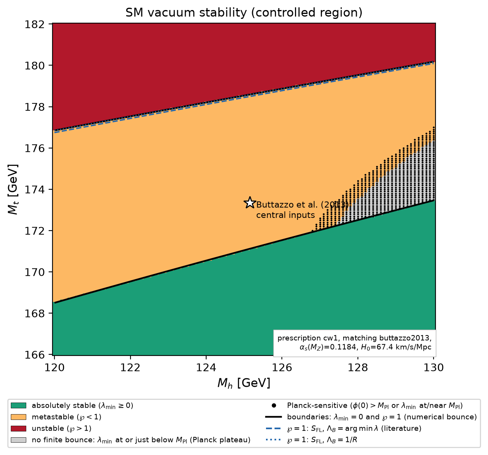
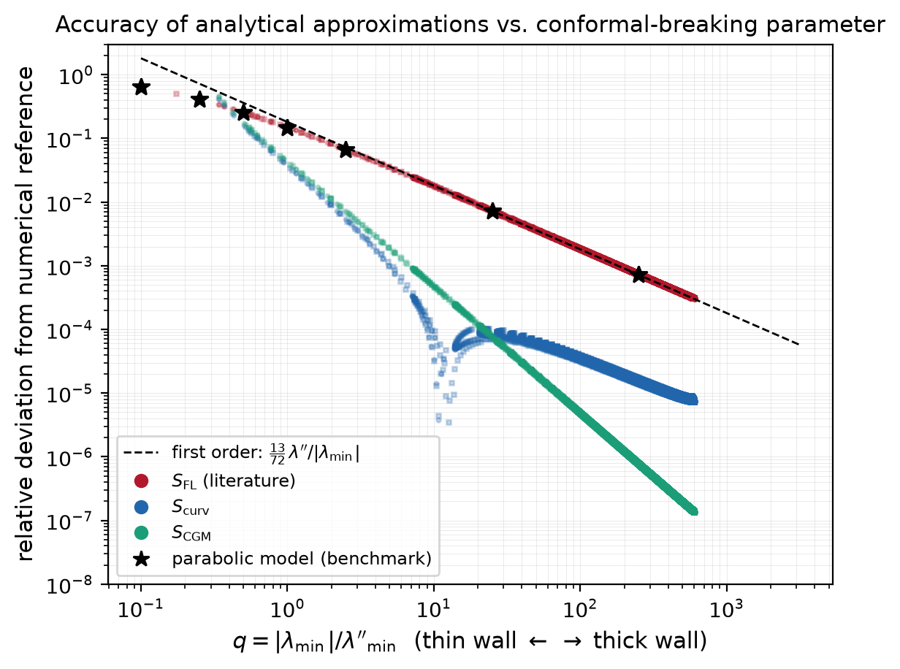
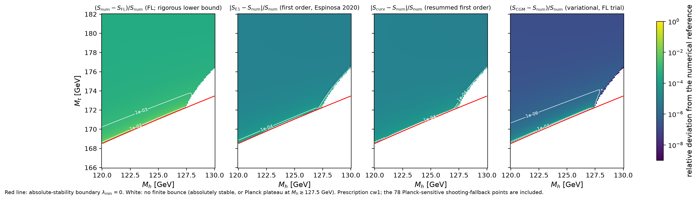
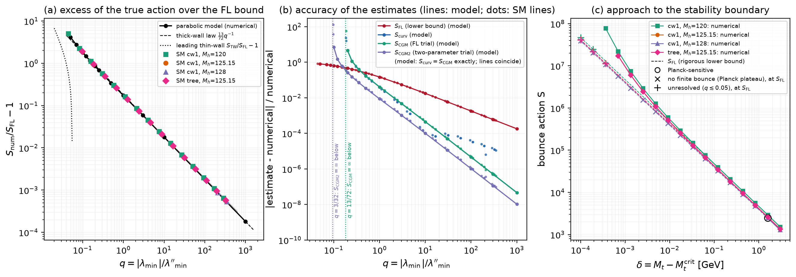
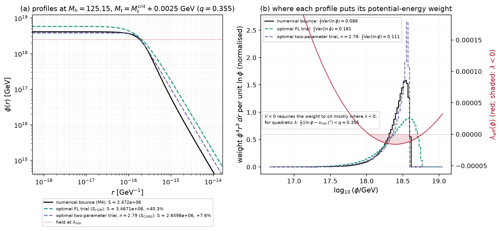
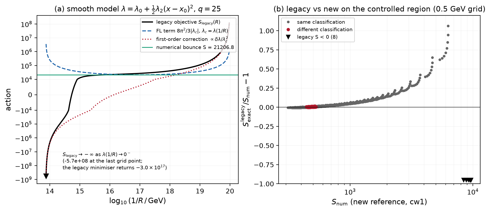

# SMVac

**A reproducible computational test of the analytical approximations to the tree-level bounce action of the
RG-improved Standard Model potential.**

SMVac solves the tree-level O(4) bounce of $V=\lambda_P(\phi)\phi^4/4$ numerically, where $\lambda_P$ is the
RG-improved quartic in the framework of Buttazzo et al. (2013). The solution comes with a validated uncertainty.
SMVac uses it as a benchmark for closed-form approximations from the literature, across the $(M_h,M_t)$ plane and
along lines approaching the absolute-stability boundary.

**Scope.** SMVac investigates the *tree-level* bounce action of the RG-improved potential. It does **not**
reproduce or improve the complete Buttazzo et al. calculation, which uses the one-loop action of Isidori, Ridolfi
& Strumia (2001), a two-loop $\lambda_{\rm eff}$, and the field anomalous dimension.

Author: Naman Goyal ([namangoyal31](https://github.com/namangoyal31)), Indian Institute of Science (IISc), Bangalore.
This is a public computational research repository; no licence has been chosen yet (see *Licence* below).

> **Status.** Version 2 (branch `formalization`) replaces the original implementation (commit `a7c070a`). An
> audit found the original "RG-improved Fubini–Lipatov action" scientifically unsound
> ([docs/REPOSITORY_AUDIT.md](docs/REPOSITORY_AUDIT.md), §10.6 below). The original code and data are preserved
> unchanged in [`legacy/`](legacy/README.md) for traceability. An independent scientific review is recorded in
> [docs/INDEPENDENT_SCIENTIFIC_REVIEW.md](docs/INDEPENDENT_SCIENTIFIC_REVIEW.md).

## What SMVac contributes

1. **A validated numerical benchmark** for the tree-level RG-improved bounce problem, scanned systematically over
   the controlled $(M_h,M_t)$ window, with per-point uncertainties and provenance.
2. **An independent numerical-method comparison and convergence validation.** Five solvers were compared. The
   checks of the chosen reference do not rely on solver agreement.
3. **A systematic test of existing analytical approximations,** on identical data selections with one error
   metric.
4. **A comparison with the perturbative treatment of Espinosa (2020),** whose first- and second-order results are
   confirmed numerically.
5. **The behaviour and limits of the variational trial families** tested here, with an elementary criterion for
   when they diverge.
6. **Thin-wall and near-critical behaviour,** including the Planck plateau of the frozen-coupling model.
7. **A statement of the physical and theoretical limitations** (§11).

The analytical results that this work tests are **prior work**, not SMVac results:

* the lower-bound method is due to Wipf (1985);
* the thick-wall expansion, i.e. the Fubini-weighted first-order action, the coefficient $13/72$, the scale
  $\phi_0=\mu_0e^{5/6}$ and the second-order term, is due to Espinosa (2020);
* earlier numerical solutions of the same tree-level problem exist at the central SM point (Di Luzio, Isidori &
  Ridolfi 2016).

## Main findings

Every number is regenerated by the scripts in §8. The categories used are:

* *rigorous*: proved, under stated assumptions;
* *variational*: an upper estimate, conditional on Coleman–Glaser–Martin attainment;
* *approximation*: a closed form that is not a bound;
* *numerical*: computed, with the uncertainty stated;
* *empirical*: an observation without theoretical explanation.

1. **Numerical benchmark (numerical).** The reference has uncertainty $\sim10^{-12}$ or better at standard-tier
   points. This is supported by checks independent of solver agreement, and by agreement with Espinosa's analytic
   second-order coefficient: $-0.01363$ numerically versus $-0.013644$ analytically.
2. **Leading formula $S_{\rm FL}=8\pi^2/(3|\lambda_{\min}|)$ (rigorous lower bound** for finite-action bounces;
   method of Wipf 1985). Over the controlled scans it is low by $3\times10^{-4}$ to $1.7\times10^{-3}$ for
   $S<5000$, and by up to 34% (`cw1`) and 50% (`tree`) near the stability boundary.
3. **First-order formula $S_{\rm E1}=S_{\rm FL}(1+\frac{13}{72q})$** (approximation; Espinosa 2020, eq. 3.21;
   $q=|\lambda_{\min}|/\lambda''_{\min}$).
   * It is the most accurate closed form near criticality: maximum error 1.54% over all 21,626 standard-tier
     controlled-scan points, and median $9\times10^{-6}$.
   * Its accuracy for $q\lesssim1$ lies outside its formal domain and is empirical. It degrades below
     $q\approx0.07$, reaching −15% at the SM point $q=0.044$.
4. **Resummed and variational estimates (approximation / variational).**
   * The variational estimate $S_{\rm CGM}$ has the smallest typical error in the bulk (median $2\times10^{-7}$).
   * $S_{\rm CGM}$ and the resummed first-order form $S_{\rm curv}=S_{\rm FL}/(1-\frac{13}{72q})$ diverge near
     $q=13/72$. Their worst errors in the scans are 46% and 42%, and each is infinite at one `tree` point.
   * A two-parameter trial family moves the divergence to $q=3/32$; it does not remove it.
   * None of these estimates is uniformly superior to the others.
5. **Why they diverge (rigorous, idealised model).** For $\lambda$ quadratic in $\ln\phi$, a fixed-shape trial
   gives a finite estimate if and only if $q>\frac12{\rm Var}(\ln g)$. This is an elementary lemma; no novelty is
   claimed.
6. **Near criticality (numerical / empirical).**
   * In the SM, $S/S_{\rm FL}-1$ follows the parabolic-model curve to 2–3% for $0.17\le q\le600$, with
     $q\approx141\,{\rm GeV}^{-1}\times(M_t-M_t^{\rm crit})$ at $M_h=125.15$ GeV.
   * The leading thin-wall asymptotics are not reached for $q\ge0.05$.
   * For $q\lesssim0.05$ ($S\gtrsim5\times10^7$) the solvers do not converge.
7. **Decay criterion (within the tree-level scheme).** The FL approximation shifts the metastability boundary by
   0.0025 GeV in $M_t$. The scheme ambiguities shift it by 0.09–0.12 GeV: the bounce-scale identification, and
   `cw1` versus `tree`.
8. **Planck scale (model-dependent).** For `cw1` and $M_h\gtrsim127$ GeV near criticality, 459 of 16,261 controlled
   points have no finite bounce once the couplings are frozen above $M_{\rm Pl}$. This conclusion depends entirely
   on that freezing.
9. **Original implementation.** Its headline quantity was a first-order expansion that is unbounded below. It
   returns $-3\times10^{17}$ on a smooth model potential.

None of this changes the established picture of a metastable SM vacuum. The contribution is a validated,
reproducible benchmark and a systematic test of the existing analytical tools, including where and why they fail.

---

## 1. Scientific motivation

The measured Higgs and top masses place the SM close to the boundary between absolute stability and
metastability of the electroweak vacuum. The quartic coupling turns negative near $10^{10}$–$10^{11}$ GeV. The
standard estimate of the vacuum lifetime uses the action of the scale-invariant Fubini–Lipatov instanton,
$S\simeq 8\pi^2/(3|\lambda_{\min}|)$, evaluated at the minimum of the running coupling (Buttazzo et al. 2013,
eq. 81). This is exact only for a constant coupling. The running of $\lambda$ breaks scale invariance, and near the
stability boundary the potential develops a second, nearly degenerate minimum below $M_{\rm Pl}$. The leading
correction from running was derived by Espinosa (2020). SMVac measures numerically:

* how large the error of the leading formula is, and where it matters;
* how well Espinosa's correction and other closed-form estimates capture the error;
* where all of them fail.

## 2. Physical problem

**Problem P** (defined precisely in [docs/STAGE_C_PLAN.md](docs/STAGE_C_PLAN.md) §2). Given $(M_h, M_t,
\alpha_s(M_Z))$:

1. compute the MS-bar couplings at $\mu=M_t$ from the NNLO fits of Buttazzo et al. (2013), eqs. 55–60;
2. evolve them with the three-loop SM RGEs (their App. B; four-loop QCD) up to $M_{\rm Pl}=1.22\times10^{19}$ GeV,
   freezing them above;
3. build the RG-improved quartic $\lambda_P(\phi)$ at $\mu=\phi$, in one of two prescriptions:
   * `cw1`: the one-loop Coleman–Weinberg $\lambda_{\rm eff}$;
   * `tree`: the MS-bar $\lambda$;
4. compute the tree-level O(4) bounce action $S$ of $V=\lambda_P(\phi)\phi^4/4$ and the decay probability in
   our past light cone, $\wp=0.15\,\Lambda_B^4e^{-S}/H_0^4$ (Buttazzo et al. eqs. 80–82), with $\Lambda_B=1/R$.

The vacuum is **stable** if $\min\lambda_P\ge0$, **metastable** if $\wp<1$, and **unstable** otherwise.
Non-SM operators (e.g. $\phi^6/M_{\rm Pl}^2$) are not part of P. They are available only as an explicit, flagged
option and never appear in SM results.

## 3. Theoretical framework and its limits

| Ingredient | Implemented | Not included (limitations) |
|---|---|---|
| Matching at $M_t$ | NNLO linear fits (Buttazzo et al. eqs. 55–60) | full NNLO matching away from the fit point |
| RG running | 3-loop $g_i, y_t, \lambda$; 2-loop $y_b, y_\tau$; 4-loop QCD | thresholds above $M_t$ (none in the SM) |
| Effective potential | one-loop CW (`cw1`) or MS-bar (`tree`), at $\mu=\phi$ | two-loop $\lambda_{\rm eff}$, field anomalous dimension $e^{4\Gamma}$, Goldstone terms |
| Decay rate | tree-level bounce action, prefactor $\Lambda_B^4$ | one-loop fluctuation determinant, gravitational corrections |
| Planck scale | couplings frozen above $M_{\rm Pl}$; affected points flagged *Planck-sensitive* | Planck-scale physics |

## 4. Mathematical formulation

With $\tau=\ln r$, $f=r\phi$ and $x=\ln\phi$, the bounce equation $\phi''+3\phi'/r=V'(\phi)$ becomes
$$f''=f+f^3\,G(x),\qquad G=\lambda+\tfrac14\,\frac{d\lambda}{dx},\qquad x=\ln f-\tau,$$
with $f\sim e^{\pm\tau}$ at the two ends. The action is $S=2\pi^2\int d\tau\,[\tfrac12(f'-f)^2+\tfrac14\lambda f^4]=T+V$.
A solution satisfies two exact identities: Derrick's $T+2V=0$, and the dilatation identity $\int(d\lambda/dx)f^4d\tau=0$.

**Analytical approximations and bounds** (derivations in [docs/SCIENTIFIC_METHODOLOGY.md](docs/SCIENTIFIC_METHODOLOGY.md) §6):

Here $q=\lvert\lambda_{\min}\rvert/\lambda''_{\min}$, with $\lambda''=d^2\lambda/d(\ln\phi)^2$ at the minimum.

| Quantity | Formula | Origin | Status |
|---|---|---|---|
| $S_{\rm FL}$ | $8\pi^2/(3\lvert\lambda_{\min}\rvert)$ | Fubini; Lipatov; Buttazzo et al. eq. (81) | **rigorous lower bound** on every finite-action bounce (Pohozaev identity + sharp Sobolev inequality; method of Wipf 1985) |
| $S_{\rm E1}$ | $S_{\rm FL}\,(1+\frac{13}{72q})$ | Espinosa (2020), eq. (3.21) | approximation (first order in $1/q$); not a bound |
| $S_{\rm E2}$ | $S_{\rm FL}\,(1+\frac{13}{72q}+\frac{c_2}{q^2})$, $c_2=-0.013644$ | Espinosa (2020), eq. (6.5) | approximation (second order); exact coefficients only for $\lambda$ quadratic in $\ln\phi$ |
| $S_{\rm curv}$ | $S_{\rm FL}/(1-\frac{13}{72q})=8\pi^2/[3(\lvert\lambda_{\min}\rvert-\tfrac{13}{72}\lambda''_{\min})]$ | resummation of $S_{\rm E1}$ | approximation; not a bound; diverges at $q=13/72$ |
| $S_{\rm CGM}$ | $8\pi^2/(3\lvert\min_h\bar\lambda(h)\rvert)$, $\bar\lambda(h)=6\int_0^1w(1-w)\lambda(hw)dw$ | Fubini-weighted average of Espinosa (2020) eqs. (3.25)–(3.27), resummed; variational method of Wipf (1985) | variational upper estimate (a rigorous bound only if the Coleman–Glaser–Martin infimum is attained) |
| $S_{\rm CGM2}$ | $\min_{h,n}T^2/(4\lvert V\rvert)$ over $\phi=h(1+(r/R)^{2n})^{-1/n}$, $T=\frac{2\pi^2h^2}{n}B(2+\frac1n,\frac1n)$ | trial family chosen here | variational upper estimate (same caveat) |

The notation map between Espinosa (2020) and SMVac is in METHODOLOGY §6.5a.

**Finiteness criterion** (elementary lemma for the idealised model, METHODOLOGY §6.6a). For
$\lambda=\lambda''[\frac12(x-x_{\min})^2-q]$, a trial $\phi=h\,g(r/R)$ gives a finite variational estimate if and
only if $q>\frac12{\rm Var}(\ln g)$, the variance being over the weight $g^4r^3dr$.

* The threshold is $13/72$ for the FL shape.
* For the two-parameter family it is $q_c(n)=[\psi'(2/n)-\psi'(4/n)]/(2n^2)$, which decreases to $3/32$ as
  $n\to\infty$.
* For the exact bounce, the Derrick and dilatation (Affleck) identities give
  $S=\frac{\pi^2}{2}\lambda''\!\int\!f^4d\tau\,\big(q-\frac12{\rm Var}_b(\ln\phi)\big)$, with
  $\langle\ln\phi\rangle_b=x_{\min}$.

## 5. Numerical methodology

The numerical reference was chosen by a systematic comparison of five methods on analytic, model and SM
benchmarks ([docs/NUMERICAL_METHOD_COMPARISON.md](docs/NUMERICAL_METHOD_COMPARISON.md)):

* M0, the legacy construction;
* M1, shooting in physical variables;
* M2, shooting in $(\tau,f)$;
* M3, adaptive collocation;
* M4, Chebyshev spectral collocation.

**Chosen reference: M4.** It uses Chebyshev–Lobatto collocation on $[\tau_c-15,\tau_c+15]$ with Robin conditions
$f'=\pm f$ and damped Newton iteration. It solves at two resolutions, 256 and 384 nodes, and doubles both (512 and
768) if the two identities do not hold to $10^{-9}$. The reported uncertainty $\delta S$ is the change between two resolutions plus the identity residuals
times $S$. Bounces that cross the frozen-coupling kink at $M_{\rm Pl}$ converge only algebraically. They are
accepted in a flagged *reduced-accuracy* tier (identities $<10^{-5}$).

**Fallback and classification.** Points where collocation fails are re-solved by the two independent shooting
solvers M1 and M2 (`validation/fallback_shooting.py`). A result is accepted only if they agree to $10^{-8}$ and
satisfy Derrick's identity to $10^{-8}$. A point is classified *no finite bounce* only if every shot of both solvers
undershoots and the variational optimum escapes to arbitrarily large field. Any other non-convergence is reported
as a solver failure.

RG evolution uses classical RK4 in $t=\ln\mu^2$ (step 0.025) with cubic-Hermite dense output of all couplings.
$\lambda_P(x)$ is represented by an adaptive Chebyshev series (tail $<10^{-14}$). An independent Python
implementation (DOP853 RGE, solvers M0–M4) serves as the cross-check.

## 6. Software architecture

```
include/smvac/ src/   C++14 library: matching, beta_functions, rge, potential, analytic, bounce, decay, stability,
                      numerics/{chebyshev, brent, quadrature}
apps/                 smvac_point (JSON report for one point), smvac_scan (grid chunk -> CSV with metadata header)
tests/                C++ tests (CTest): power counting, literature values, convergence, analytic limits,
                      independent multi-method references, failure modes, end-to-end pipeline
python/smvac/         run_scan.py (parallel scans from configs/*.toml); reference/ = independent Python
                      implementation (DOP853 RGE, Chebyshev potential, solvers M0-M4, analytic and variational estimates)
python/tests/         Python tests (unittest)
configs/              scan definitions: controlled region (cw1, tree) and exploratory wide scan
validation/           method comparison, convergence/precision/discretisation checks, derivation checks, shooting
                      fallback, near-critical study, legacy comparison, scan analysis, figures, reproducibility check
results/              scan outputs (gzip CSV with metadata headers), fallback results, summary.json
figures/              generated figures, with captions in figures/README.md
audit/                Stage A/B audit tooling (validated port of the legacy solver, experiments)
legacy/               original implementation, scripts, data and figures (frozen)
docs/                 audit, methodology, numerical review, design record, method comparison, validation report,
                      independent scientific review
```

## 7. Installation

Requirements:

* a C++14 compiler (tested with MinGW.org GCC 6.3 on Windows);
* CMake ≥ 3.10 and a generator (Ninja or Make);
* Python ≥ 3.11 with `numpy`, `scipy`, `pandas`, `matplotlib` (`pip install -r requirements.txt`).

```bash
cmake -S . -B build -G Ninja -DCMAKE_BUILD_TYPE=Release
cmake --build build
ctest --test-dir build --output-on-failure
python -m unittest discover -s python/tests
```

## 8. Reproducing the results

Scripts that call the C++ binary expect it at `build/smvac_point`. Costs were measured on a 12-thread laptop.

```bash
./build/smvac_point 125.15 173.34                              # full report for one point (JSON)
python python/smvac/run_scan.py configs/controlled.toml       # results/controlled_cw1.csv        (20 min, 10 workers)
python python/smvac/run_scan.py configs/controlled_tree.toml  # results/controlled_tree.csv       (10 min)
python python/smvac/run_scan.py configs/exploratory.toml      # results/exploratory_cw1.csv       (3 min)
python validation/fallback_shooting.py results/controlled_cw1.csv.gz --workers 5   # *_fallback.csv (~20 min)
python validation/analyze_scans.py                            # results/summary.json
python validation/near_critical.py                            # validation/results/near_critical_*.csv (~12 min, SMVAC_WORKERS=10)
python validation/analyze_near_critical.py                    # validation/results/near_critical_summary.json
python validation/compare_approximations.py                   # validation/results/approximation_comparison.{json,md}
python validation/method_comparison.py                        # validation/results/method_comparison.csv
python validation/summarize_comparison.py                     # validation/results/method_comparison_tables.md
python validation/convergence_study.py                        # validation/results/convergence.csv
python validation/discretization_checks.py                    # validation/results/discretization_checks.txt
python validation/verify_derivations.py                       # validation/results/derivation_checks.txt
python validation/legacy_comparison.py --driver legacy_driver # validation/results/legacy_comparison.csv (driver build: audit/README.md)
python validation/make_figures.py                             # figures/*.png
python validation/reproduce_sample.py --binary build/smvac_point   # seeded stratified recomputation vs stored results
python validation/check_links.py                              # broken references in the documentation
```

The long-double comparison is not built by default:
`cmake --build build --target precision_check`, then `./build/precision_check > validation/results/precision_check.csv`.

* **Stored outputs.** The committed scan outputs are gzip-compressed (`results/*.csv.gz`). All scripts read either
  form, and a freshly generated plain `.csv` takes precedence.
* **Metadata.** Each scan CSV begins with a metadata header recording the code version and git commit, all physics
  options (prescription, matching, $\alpha_s$, $H_0$, whether the BSM deformation is on), the solver settings, the
  grid and the timestamps.
* **Provenance of the committed scans.** The headers of `results/*.csv.gz` record `git_commit = bb4b5b7…-dirty`;
  the files are left unchanged.
  * They were produced on 2026-11-08 between 19:25 and 19:58 UTC, by a binary built at 19:23 UTC.
  * The build used commit `bb4b5b7` plus one uncommitted change, `BounceOptions::max_nodes = 1024` in
    `include/smvac/bounce.hpp`. That change was later committed in `ad63002`.
  * `bb4b5b7` was renamed `1d0d435` by a later edit that changed only the commit message; the content is
    identical.
  * Other source edits made during the scans did not reach the scan binary, which was not rebuilt. These were
    two accessor methods, and a stagnation-threshold experiment compiled only in a scratch directory and then
    reverted.
  * The scan-relevant C++ source of `ad63002` differs from the scan build only by those two accessors, which the
    scan code does not call.
  * This build history is reconstructed from the development record and file timestamps; the repository itself
    records only `bb4b5b7…-dirty`.
  * `validation/reproduce_sample.py` recomputed 233 seeded, stratified points from a clean build of `ad63002`,
    and all matched the stored values: 227 scan points (about 0.5% of 42,622) at $10^{-12}$, 4 shooting-fallback
    points and 2 near-critical model points.

  This is supporting evidence, not a regeneration of the complete scans. The scans are not claimed to come from
  an exact clean checkout of `ad63002`.
* **Per-point cost** (`build/smvac_point`, unloaded): 0.36 s for a typical point, 2.3 s for a reduced-accuracy
  point.

## 9. Validation and numerical reliability

Summary of [docs/VALIDATION_REPORT.md](docs/VALIDATION_REPORT.md):

* **RG running.** The couplings at $M_{\rm Pl}$ reproduce Buttazzo et al. (2013) eq. (61) to its quoted precision.
  The C++ (RK4 + Hermite) and Python (DOP853) implementations agree to $10^{-10}$ in $\lambda(M_{\rm Pl})$, with
  RK4 converging at fourth order.
* **β-functions.** They pass a literature-independent loop-order power-counting test, which also detects the
  transcription errors of the original code.
* **Bounce solver.** It reproduces the Fubini–Lipatov action for constant $\lambda$ to $10^{-10}$. It agrees with
  the independent solvers M1/M2 to $\lesssim10^{-11}$ relative on thick-wall, thin-wall and SM benchmarks
  ($2\times10^{-10}$ at the closest near-critical benchmark, $S\approx2\times10^6$). The
  solver checks below are independent of that agreement:
  * exponential self-convergence in $N$;
  * long-double re-solution ($\le4\times10^{-15}$);
  * domain size ($<10^{-14}$);
  * off-node ODE residuals at the round-off floor;
  * quadrature-rule independence ($\le1.5\times10^{-12}$);
  * ulp perturbations of the potential coefficients ($\le3\times10^{-13}$);
  * the exact identities, monitored at every point.
* **Uncertainty.** The numerical uncertainty of $S$ is $\sim10^{-14}$ relative at generic points and
  $\sim10^{-12}$ near criticality. The per-point estimate is $\le1.1\times10^{-9}$ (standard tier) and $\sim10^{-6}$
  for reduced-accuracy points at the Planck kink. Numerical, approximation, parametric, theoretical and
  Planck-model uncertainties are kept separate (VALIDATION_REPORT §8).
* **Bounds.** No solved point violates $S_{\rm FL}\le S_{\rm num}\le S_{\rm CGM}$.
* **Reproducibility.** A seeded, stratified sample of stored results is recomputed from the committed source by
  `validation/reproduce_sample.py`. It covers every status class, the reduced-accuracy and Planck-sensitive
  points, shooting-fallback points and near-critical model points.

## 10. Results

The controlled region is $M_h\in[120,130]$ GeV, $M_t\in[166,182]$ GeV, scanned on a 0.1 GeV grid (16,261 points
per prescription). All numbers below are generated by three scripts. Figure captions are in
[figures/README.md](figures/README.md).

* `validation/analyze_scans.py` → `results/summary.json`;
* `validation/analyze_near_critical.py` → `validation/results/near_critical_summary.json`;
* `validation/compare_approximations.py` → `validation/results/approximation_comparison.json`.



**Phase structure.** The table counts points by status for prescription `cw1`, after the shooting fallback. No
unresolved points remain.

| status | points |
|---|---|
| stable | 5117 |
| metastable | 7130 (7052 by collocation; 78 by shooting, all Planck-sensitive) |
| unstable | 3555 |
| no finite bounce (Planck plateau; metastable by $S\ge S_{\rm FL}$, §10.5) | 459 |

For `tree` the counts are 5067 stable, 7519 metastable and 3675 unstable, with no failures and no Planck-sensitive
points. The boundaries at $M_h=125.2$ GeV are:

| boundary | `cw1` | `tree` |
|---|---|---|
| absolute stability, $\lambda_{\min}=0$ | $M_t=171.144$ GeV | 171.094 GeV |
| metastability, $\wp=1$, numerical bounce | $M_t=178.604$ GeV | 178.484 GeV |

### 10.1 How accurate is the literature approximation $S_{\rm FL}=8\pi^2/(3|\lambda_{\min}|)$?



* **It is a rigorous lower bound, and it holds at every scan point.**
* **In the bulk of the metastable and unstable region it underestimates the action by $3.1\times10^{-4}$ to
  $1.7\times10^{-3}$ relative.** The bulk means $S<5000$, which is 9,971 points.
  - The error follows the first-order law of Espinosa (2020),
    $(S-S_{\rm FL})/S_{\rm FL}\to\frac{13}{72}\lambda''_{\min}/|\lambda_{\min}|$, as the wall thickens.
  - On the parabolic model the ratio of the two is 0.99998 at $q=3000$, 0.9993 at $q=100$ and 0.993 at $q=10$
    (`validation/results/derivation_checks.txt`). The remainder matches Espinosa's second-order coefficient
    (METHODOLOGY §6.5a).
* **It degrades toward the absolute-stability boundary.** For $S>10^4$ the median error is $6.6\times10^{-3}$. The
  maximum is 34% (`cw1`) and 50% (`tree`). There $|\lambda_{\min}|\to0$, the second minimum becomes nearly
  degenerate, and the bounce becomes thin-walled (§10.4).
* **Near the metastability boundary, where it matters for the classification ($450<S<650$), the absolute error is
  0.14–0.25 units of action.** This moves the metastability boundary by only 0.0025 GeV in $M_t$.

### 10.2 All approximations on identical selections

All approximations are evaluated on the same points, the 21,626 standard-tier points of both controlled scans:
not Planck-sensitive, not reduced-accuracy, $\lambda''>0$. The error is $e=(S_{\rm est}-S_{\rm num})/S_{\rm num}$; an
infinite estimate counts as $|e|=\infty$. Entries are median $|e|$ / max $|e|$, from
`validation/results/approximation_comparison.md`.

| estimate | bulk, $q\ge10$ (21,481 points) | $1\le q<10$ (118) | near-critical, $0.1\le q<1$ (27) | all (21,626) |
|---|---|---|---|---|
| $S_{\rm FL}$ (lower bound) | $3.8\times10^{-4}$ / 0.018 | 0.025 / 0.144 | 0.226 / 0.504 | $3.9\times10^{-4}$ / 0.504 |
| $S_{\rm E1}$ (first order) | $9.2\times10^{-6}$ / $2.9\times10^{-4}$ | $3.0\times10^{-4}$ / $3.4\times10^{-3}$ | $8.5\times10^{-3}$ / **0.0154** | $9.2\times10^{-6}$ / **0.0154** |
| $S_{\rm E2}$ (second order) | $9.3\times10^{-6}$ / $4.2\times10^{-4}$ | $5.7\times10^{-4}$ / $7.3\times10^{-3}$ | 0.021 / 0.212 | $9.3\times10^{-6}$ / 0.212 |
| $S_{\rm curv}$ (resummed) | $9.1\times10^{-6}$ / $1.0\times10^{-4}$ | $3.4\times10^{-4}$ / 0.034 | 0.110 / $\infty$ (1 point) | $9.1\times10^{-6}$ / $\infty$ |
| $S_{\rm CGM}$ (variational) | $2.1\times10^{-7}$ / $4.7\times10^{-4}$ | $9.2\times10^{-4}$ / 0.039 | 0.121 / $\infty$ (1 point) | $2.1\times10^{-7}$ / $\infty$ |

* The $S_{\rm E1}$ maximum (+1.54%) lies at $(M_h,M_t)=(124.1,170.6)$ GeV (`cw1`, $q=0.338$). The single infinite
  case of $S_{\rm curv}$ and $S_{\rm CGM}$ is at $(120.1,168.5)$ GeV (`tree`, $q=0.173$); the largest finite errors are
  42% and 46%.
* In the bulk, $S_{\rm CGM}$ is the most accurate typical estimate. Formulas that use only $\lambda''$ are limited to
  about $10^{-5}$ by the cubic and higher terms of $\lambda(\ln\phi)$.
* Near criticality, $S_{\rm E1}$ is the most accurate.
* No estimate is uniformly best.
* $S_{\rm CGM2}$ exists only on the near-critical study (§10.4).
* On the exploratory scan (1,699 standard-tier points, $q\ge2.9$, uncontrolled inputs), the maximum errors are 6.0%
  ($S_{\rm FL}$), 0.23% ($S_{\rm E1}$), 0.37% ($S_{\rm E2}$), 0.28% ($S_{\rm curv}$) and 0.57% ($S_{\rm CGM}$).



### 10.3 What dominates the uncertainty of the decay criterion?

| effect | kind | size near the metastability boundary | shift of the $\wp=1$ boundary at $M_h=125.2$ GeV |
|---|---|---|---|
| FL approximation of the bounce action | approximation | 0.14–0.25 units of $S$ | −0.0025 GeV |
| identification of the bounce scale ($\Lambda_B=\arg\min\lambda$ vs $1/R$) | theoretical (RG improvement) | median 7.3 units in the threshold | −0.094 GeV |
| prescription `cw1` vs `tree` | theoretical (RG improvement) | 2.6–5% of $S$ (median 2.7%) | −0.12 GeV |
| numerical uncertainty of the reference | numerical | $\lesssim10^{-9}$ relative | negligible |

For the tree-level decay criterion, then, the approximation error of the standard analytical formula is
negligible compared with the scale-identification and prescription ambiguities of RG improvement. Those
ambiguities are, in turn, formally of the order of the omitted one-loop determinant.

### 10.4 Near criticality: which closed forms survive, and why the resummed and variational ones fail



The approach to the absolute-stability boundary was studied on two families:

* a parabolic model $\lambda=\lambda''[\frac12(x-x_0)^2-q]$ with $q$ from 1000 down to 0.05;
* four SM lines at fixed $M_h$, with $M_t=M_t^{\rm crit}+\delta$ and $\delta=10^{-4}$–$3$ GeV: `cw1` at
  $M_h=120$, 125.15 and 128 GeV, and `tree` at 125.15 GeV.

Details are in METHODOLOGY §6.6a and VALIDATION_REPORT §5.3.

| estimate | $\lvert e\rvert$ first reaches 1% at | … 10% at | finite for | thick-wall error |
|---|---|---|---|---|
| $S_{\rm FL}$ (bound) | $q=17.8$ ($\delta=0.13$ GeV) | $q=1.55$ (0.011 GeV) | all $q$ (error < 100%) | $\frac{13}{72}q^{-1}$ (Espinosa 2020) |
| $S_{\rm E1}$ (first order, Espinosa 2020) | $q=0.72$ (model) | $q=0.05$ (model) | all $q$ | $0.0136\,q^{-2}$ (Espinosa eq. 6.5) |
| $S_{\rm CGM}$ (FL trial) | $q=2.06$ (0.015 GeV) | $q=0.64$ (0.0046 GeV) | $q>13/72$ | $0.046\,q^{-2}$ $=(13/72)^2-c_2$ |
| $S_{\rm CGM2}$ (two-parameter trial) | $q=0.93$ (0.0069 GeV) | $q=0.30$ (0.0022 GeV) | $q>3/32$ | $0.010\,q^{-2}$ (fit) |

* The $q$ values are from the idealised parabolic model.
* The $\delta$ values are from the SM `cw1` line at $M_h=125.15$ GeV, where $q\approx141\,\delta/{\rm GeV}$; the
  other lines agree after rescaling by $q/\delta$.
* On the SM lines, $S_{\rm E1}$ stays within 1.7% for $q\ge0.097$ ($\delta\ge0.7$ MeV).
* For quadratic $\lambda$, $S_{\rm curv}=S_{\rm CGM}$; in the SM the thresholds of $S_{\rm curv}$ are within 15% of
  those of $S_{\rm CGM}$.

* **One parameter.** Away from the Planck plateau, $S/S_{\rm FL}-1$ in the SM equals the model value at the same $q$
  to 2–3%. This holds along the lines and over all 21,626 standard-tier points of both controlled scans. The
  model thresholds therefore transfer directly to the SM.
* **Crossover.** $S_{\rm CGM}$ is less accurate than the bound $S_{\rm FL}$ for $q<0.39$ ($\delta<0.003$ GeV), and
  $S_{\rm CGM2}$ for $q<0.16$ ($\delta<0.0013$ GeV). The bound's error is capped at 100%, while the upper estimates
  diverge. $S_{\rm E1}$ is more accurate than every other estimate at all model points with $q\le0.5$.
* **Mechanism of the divergence.** A trial of fixed shape $g$ samples field values with a fixed spread. With the
  weight $g^4r^3dr$, its estimate is finite only if $\frac12{\rm Var}(\ln g)<q$ (exact for quadratic $\lambda$).
  - For the FL shape this gives $13/72$. For the two-parameter family the minimum over $n$ is $3/32$, reached as
    $n\to\infty$.
  - Every member of both families has a tail $h(R/r)^2$ tied to its core value $h$. That tail always samples
    fields below the window where $\lambda<0$.
  - The exact bounce has $\frac12{\rm Var}_b(\ln\phi)<q$ at every $q$: as $q\to0$ it forms a flat core and a
    thin wall with a much weaker tail ([figure](figures/variational_failure.png)).
  - Curing the divergence would need a trial family with at least a third, tail-decoupling parameter. None is
    implemented.
* **Closed forms in the crossover window $0.05\lesssim q\lesssim1$.**
  * The resummed and variational estimates fail there, and so does the second-order truncation (an asymptotic
    series).
  * The unresummed first-order formula $S_{\rm E1}$ does not fail: $\le2.7\%$ on the model for $q\ge0.1$, and
    $\le1.7\%$ on the SM lines for $q\ge0.097$. This accuracy is empirical, with no theoretical error control.
    $S_{\rm E1}$ degrades to −10% at $q=0.05$ (model) and −15% at $q=0.044$ (SM).
  * The leading-order Coleman thin-wall action is too small by a factor 15.7 at $q=0.15$ and 4.2 at $q=0.05$, and
    it lies even below the rigorous bound for $q>0.056$.
  * Where a controlled answer is needed in this window, the numerical solution is the reference.
* **Scaling with $\delta$.** $S\propto\delta^{-1.01}$ for $\delta=1$–$3$ GeV (thick wall). The local exponent
  steepens to $-1.43$ (`cw1` and `tree`, 125.15) and $-1.69$ (`cw1`, 120) at the smallest solved $\delta$.
* **Practical relevance is small.** The estimates err by more than 1% only where $S>3\times10^4$, far from the
  metastability boundary ($S\approx560$). At the central inputs of Buttazzo et al. ($\delta=2.2$ GeV, $q=258$)
  $S_{\rm FL}$ is low by $7\times10^{-4}$.



### 10.5 Planck plateau, solver failures and Planck sensitivity

* **The plateau.** For `cw1` and $M_h\gtrsim127$ GeV, the minimum of $\lambda_{\rm eff}$ lies at, or within 0.22
  decades below, $M_{\rm Pl}$.
  - With couplings frozen above $M_{\rm Pl}$, $\lambda$ rises by at most $7\times10^{-6}$ before the plateau.
  - At 459 controlled points (177 with the minimum on the boundary, 282 just below it), no finite-action bounce
    exists. The infimum $8\pi^2/(3|\lambda(M_{\rm Pl})|)\le1.024\,S_{\rm FL}$ is approached only by bubbles
    escaping into the plateau.
  - All have $S_{\rm FL}\ge1301$. The bound applies to bounces, and to the mountain-pass barrier of any escape path,
    not to arbitrary configurations (VALIDATION_REPORT §5.2). Hence the barrier exceeds the $\wp=1$ threshold
    $S=559.3$, under three assumptions: the frozen-coupling potential, $\Lambda_B\le M_{\rm Pl}$, and the
    semiclassical tree-level treatment. On those assumptions the points are metastable.
  - **This conclusion, and the existence or absence of a bounce itself, depend entirely on freezing the couplings
    above $M_{\rm Pl}$.** Their lifetime is not an SM prediction.
  - Along `cw1`, $M_h=128$ GeV, this covers the entire near-critical region ($\delta\le0.83$ GeV). The analytical
    estimates cannot be assessed there.
* **Planck-sensitive bounces.** Another 78 points have finite bounces centred above $M_{\rm Pl}$
  ($\phi(0)=10^{19.15}$–$10^{20.74}$ GeV). Collocation fails on the kink there. Shooting (M1 and M2 agreeing to
  $5\times10^{-10}$) solves them. They are accurate numerically, but they too depend on the freezing.
* **Genuine numerical failures** remain only in the deep thin-wall regime $q\lesssim0.05$ ($S\gtrsim5\times10^7$)
  of the near-critical lines. There neither collocation nor shooting converges. These points are not
  Planck-sensitive. By the same barrier bound and assumptions they are metastable ($S_{\rm FL}>1.1\times10^7$).

### 10.6 The original implementation

The original "RG-improved Fubini–Lipatov action" was shown to be a first-order perturbative estimate about the FL
instanton, minimised over the instanton size. It is unbounded below. It returns $-3\times10^{17}$ on a smooth
model potential and negative values at 8 of 693 controlled-region points. The reported deviations from $S_{\rm FL}$
came from an undocumented $\phi^6/M_{\rm Pl}^2$ term and from Planck-scale artefacts. On the 0.5 GeV comparison
grid, the old and new classifications agree at 86% of points (VALIDATION_REPORT §6).



## 11. Limitations and open questions

* **Tree-level action only.** The one-loop fluctuation determinant is not computed. Its effect on the decay
  exponent, and the prescription dependence it would cancel (`cw1` vs `tree`; $\Lambda_B$ identification), are
  larger than the analytical-approximation errors quantified here.
* **Local matching inputs.** The linear NNLO fits restrict controlled statements to the window above. The
  exploratory $[0,250]^2$ GeV scan is an uncontrolled extrapolation (`figures/exploratory_wide_scan.png`).
* **Simplified $\lambda_{\rm eff}$.** No two-loop terms and no $e^{4\Gamma}$, so absolute-stability boundaries
  differ slightly from Buttazzo et al. eq. (64).
* **Planck scale.** Points whose bounce reaches $\phi\gtrsim M_{\rm Pl}$, and the 459 plateau points, depend on the
  arbitrary freezing of the couplings. They are flagged. Gravitational corrections are not included.
* **Deep thin wall.** For $q\lesssim0.05$ only the rigorous lower bound is available.
* **Scope of the analytical results.** The finiteness criterion and the exact-bounce identity hold for the
  idealised potential quadratic in $\ln\phi$. Statements about the SM rest on the numerical data.
* **Not a full lifetime calculation.** SMVac does not compute the one-loop decay rate of Buttazzo et al. (2013),
  Isidori et al. (2001) or later work (e.g. Chigusa, Moroi & Shoji 2017; Andreassen, Frost & Schwartz 2018). Its
  statements about "errors of the literature formula" are internal to the tree-level RG-improved scheme. They are
  not corrections to published lifetimes.
* **Open questions.**
  - Why does the unresummed first-order formula remain accurate far outside its formal domain, and can its error
    be bounded?
  - Is there a closed-form approximation with controlled error through the crossover window
    $0.05\lesssim q\lesssim1$? A trial family with a decoupled tail, or matched thin-wall asymptotics, are
    candidates.
  - How does the near-critical structure change with the one-loop determinant and with a physical Planck-scale
    completion?

## 12. References

1. D. Buttazzo, G. Degrassi, P.P. Giardino, G.F. Giudice, F. Sala, A. Salvio, A. Strumia, *Investigating the
   near-criticality of the Higgs boson*, JHEP 12 (2013) 089, arXiv:1307.3536.
2. S. Fubini, Nuovo Cim. A 34 (1976) 521; L.N. Lipatov, Sov. Phys. JETP 45 (1977) 216.
3. S. Coleman, Phys. Rev. D 15 (1977) 2929; C.G. Callan, S. Coleman, Phys. Rev. D 16 (1977) 1762.
4. S. Coleman, V. Glaser, A. Martin, Commun. Math. Phys. 58 (1978) 211.
5. T. Aubin, J. Differential Geom. 11 (1976) 573; G. Talenti, Ann. Mat. Pura Appl. 110 (1976) 353.
6. T. van Ritbergen, J.A.M. Vermaseren, S.A. Larin, Phys. Lett. B 400 (1997) 379.
7. L.N. Trefethen, *Spectral Methods in MATLAB*, SIAM (2000) (Chebyshev differentiation and Clenshaw–Curtis weights).
8. J. R. Espinosa, *Vacuum decay in the Standard Model: analytical results with running and gravity*, JCAP 06 (2020)
   052, [doi:10.1088/1475-7516/2020/06/052](https://doi.org/10.1088/1475-7516/2020/06/052),
   [arXiv:2003.06219](https://arxiv.org/abs/2003.06219).
9. A. Wipf, *Upper and lower bounds for the bounce action*, J. Phys. A: Math. Gen. 18 (1985) 2521–2529.
10. R. Sato, M. Takimoto, *Absolute lower bound on the bounce action*, Phys. Rev. Lett. 120 (2018) 091802,
    [arXiv:1707.01099](https://arxiv.org/abs/1707.01099).
11. L. Di Luzio, G. Isidori, G. Ridolfi, *Stability of the electroweak ground state in the Standard Model and its
    extensions*, Phys. Lett. B 753 (2016) 150, [arXiv:1509.05028](https://arxiv.org/abs/1509.05028).
12. G. Isidori, G. Ridolfi, A. Strumia, *On the metastability of the Standard Model vacuum*, Nucl. Phys. B 609 (2001)
    387, [hep-ph/0104016](https://arxiv.org/abs/hep-ph/0104016).
13. A. Andreassen, W. Frost, M. D. Schwartz, *Scale invariant instantons and the complete lifetime of the Standard
    Model*, Phys. Rev. D 97 (2018) 056006, [arXiv:1707.08124](https://arxiv.org/abs/1707.08124).
14. S. Chigusa, T. Moroi, Y. Shoji, *State-of-the-art calculation of the decay rate of electroweak vacuum in the
    Standard Model*, Phys. Rev. Lett. 119 (2017) 211801, [arXiv:1707.09301](https://arxiv.org/abs/1707.09301).

## Citation

Please cite via [`CITATION.cff`](CITATION.cff):

```bibtex
@software{goyal_smvac,
  author = {Goyal, Naman},
  title  = {SMVac: Standard Model electroweak vacuum stability --- analytical approximations versus a numerical reference},
  url    = {https://github.com/namangoyal31/SMVac},
  note   = {Indian Institute of Science (IISc), Bangalore}
}
```

## Licence

No licence file is currently provided; the licensing decision rests with the author. The `LICENSES/` directory
contains licence texts for third-party software (Bertini, GMP/MPFR) that this repository does not use (see
[docs/REPOSITORY_AUDIT.md](docs/REPOSITORY_AUDIT.md) §7).
